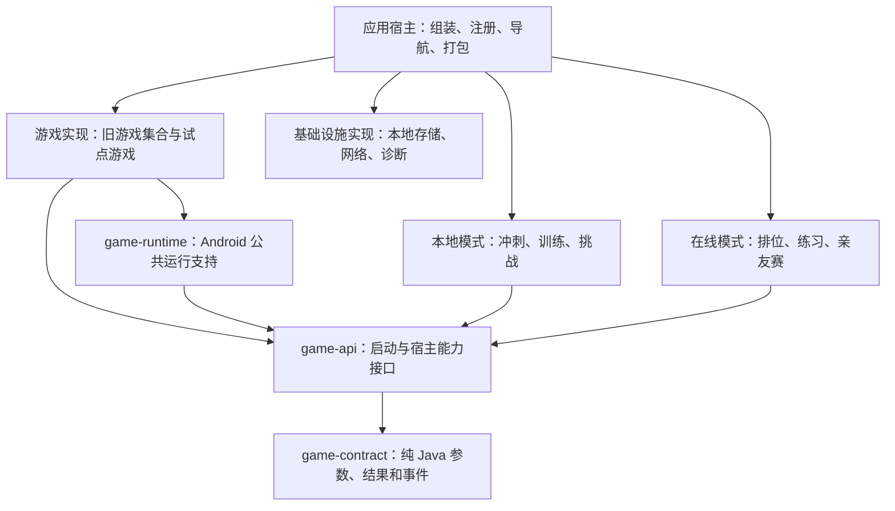

# Android 游戏模块化方案

> - 状态：建议稿，尚未实施
> - 编写日期：2026-10-23
> - 分析基线：`main @ ec6d4be`（迁移 AndroidX，并将 targetSdk 升至 35）
> - 适用范围：`android_memory-game-reborn/`；服务端仅作为现有协议兼容性的验证对象
> - 本次交付：设计文档，不包含业务代码修改、构建验证或设备验收

## 1. 决策摘要

采用**先解耦职责、再拆 Gradle 模块**的渐进方案，保留现有 Java、Activity 和 XML。

优先解决三个问题：

1. 将具体玩法与宿主能力分离，避免游戏直接访问数据库、应用实现和在线会话。
2. 将单机、训练、挑战、联机等模式的编排与游戏实现分离。
3. 明确游戏注册、资源归属及兼容性约束，再用少量游戏验证独立模块。

推荐试点顺序：

- **Game3 Hexagons**：验证离线游戏及其 View、资源可以独立编译和运行。
- **Game11 Correctly**：验证题目逻辑与展示分离，并覆盖现有在线与多人模式。
- **Game20 Colors**：进一步验证连续限时玩法与不同模式的计时接口。

不以“一款游戏一个 Gradle 模块”为初始目标，不将现有 `games/`、`logic/`、`ui/` 目录机械地转换为模块，也不把 `Game1MemoryGridActivity` 原样搬到 `core`。

**成功标准不是模块数量增加，而是依赖关系可约束、游戏可以独立测试、现有行为不变。**

## 2. 目标与非目标

### 2.1 目标

- 修改某款游戏时，尽量不影响菜单、账号和联机基础设施。
- 新增游戏时，通过统一注册和模式适配接入，不继续扩大公共基类。
- 将容易测试的出题、判定、难度推进逻辑与 Android 展示分离。
- 保持 23 款游戏的存档、入口、教程、资源和现有模式行为兼容。
- 为后续按维护频率、共享资源和团队职责拆分游戏集合建立基础。

### 2.2 非目标

本次模块化不同时开展以下工作：

- 全面改写为 Kotlin、Compose、MVVM 或单 Activity 架构。
- 替换 ActiveAndroid、重做账号系统或更改联网协议。
- 改变计分、奖励、关卡难度、暂停规则或联机池。
- 引入动态下载、插件加载、远程代码或 Play Dynamic Feature。
- 创建可以覆盖所有小游戏的通用游戏引擎。
- 强行让 Android 与 HarmonyOS 共用 UI 或运行时。
- 承诺模块化后 APK 必然减小、构建时间必然缩短。

普通 `java-library` 与 `com.android.library` 已足够支持当前目标。

## 3. 现状与关键约束

### 3.1 工程状态

当前 Android 根项目自身使用 `com.android.application`，尚无独立 `:app` 或其他 Gradle 子模块。

| 项目 | 当前状态 |
|---|---|
| 构建工具 | Android Gradle Plugin 8.13.2 / Gradle 8.13 / JDK 17 |
| Java 源码兼容级别 | Java 8 |
| SDK | minSdk 21 / targetSdk 35 / compileSdk 36 |
| UI 技术 | Java、Activity、自定义 View、XML、AndroidX |
| 绑定与资源 | ButterKnife、final/transitive R、部分资源反射 |
| 本地持久化 | ActiveAndroid |
| 游戏组织 | 23 个游戏 Activity，其中 22 个直接继承 Game1 |

第一批子模块可以直接由现有根 application 项目依赖，**不要求先把整个工程搬进 `app/`**。将根 application 重排为标准 `:app` 是可单独实施的目录整理，不应和第一款游戏拆分绑定。

### 3.2 Game1 同时包含具体玩法和公共宿主

`Game1MemoryGridActivity` 自己创建 `RectangularGrid`，同时承担游戏生命周期、状态流、单机和在线分支、记录保存、HUD、音效及多人同步等职责。

因此需要分离的是职责，而不是只改变类名或所在目录。过渡期可以保留这个类，但应逐步将宿主操作委托给接口和适配器。

### 3.3 GameGrid 不是干净的统一玩法契约

现有 `GameGrid` 混合旋转、图片、格子操作、动画和输入。部分实现存在空方法或 `UnsupportedOperationException`，部分回调在不同游戏中的含义也不一致。

处理原则：

- 保留旧接口作为兼容层，不再扩展为包含所有能力的接口。
- 以实际使用为依据，逐步抽取输入、展示、计时、关卡进度等小接口。
- 对旧事件先记录真实语义，再映射到新事件，不能仅按方法名称判断含义。

### 3.4 游戏注册集中，但元数据和业务仍然混合

`Games.java` 已有集中 Activity 映射，还同时维护分类、奖杯、教程、展示顺序和闯关导航。

方案应整理现有注册机制，而不是新增另一套并行注册表。纯公共层不能依赖 `Games` 中的具体 Activity 和业务导航。

### 3.5 模式接入存在具体实现耦合

- 在线桥接直接持有 Game1 类型。
- 部分会话逻辑根据 Activity 的 Intent 判断是否转发到多人模式。
- 部分游戏直接读取 `OnlineSession` 或 `PartySession` 的时间。
- 数据写入不仅存在于基类，个别游戏自身也处理 session、重玩和奖励。

因此，仅抽取网络接口或只替换基类的保存方法，不足以完成游戏解耦。

### 3.6 资源和存档也是架构边界

- 类名 `GameN` 不等于持久化游戏 ID；例如 Game3 对应 `"2"`，Game11 对应 `"10"`，Game20 对应 `"19"`。
- 现有闯关还依赖英文名称映射，不能随类名或模块命名一起修改。
- `MemoryApplicationModel` 通过反射枚举包含 `icg_` 的 drawable 字段。
- 部分内嵌第三方控件通过自定义 `R` 代理引用应用资源。

迁移必须同时检查入口、稳定身份、资源集合和 Release 保留规则，不能以 Java 编译成功作为唯一依据。

## 4. 目标架构

### 4.1 目标依赖关系

下图表示**编译依赖**；运行时由应用宿主组装并提供接口实现。图中的模式层和游戏集合是目标职责边界，不要求第一阶段全部变成独立 Gradle 模块。

数据访问也应通过职责明确的接口完成；上图省略其独立契约，避免把数据库、账号和所有基础设施接口都塞进 `game-contract`。

### 4.2 建议的模块职责

| 边界 | 类型 | 负责内容 | 不负责内容 |
|---|---|---|---|
| 应用宿主，后续可命名 `:app` | Android application | Application、顶层导航、实现组装、完整注册表、签名和打包 | 具体玩法规则 |
| `:core:game-contract` | Java library | 游戏 ID、不可变启动数据、事件、结果及必要的纯逻辑接口 | Android、资源、ORM、联网实现 |
| `:core:game-api` | Android library | Android 游戏入口、展示描述、启动接口、宿主能力获取契约 | 具体游戏、账号和应用实现 |
| `:core:game-runtime` | Android library | 生命周期适配、公共调度、计时接入、公共游戏界面支持 | 具体出题、奖励规则、网络协议处理 |
| `:games:hexagons` 等试点 | Android library | 对应玩法、专属 View、难度推进和资源 | 菜单、数据库实现、在线会话实现 |
| `:games:legacy`，按需建立 | Android library | 尚未细拆但已消除宿主反向依赖的旧游戏集合 | 新的永久公共大基类 |
| 本地模式层，后续可独立 | Android library 或宿主内包 | 训练计划、挑战、解锁、奖励及保存协调 | 游戏绘制、具体题目生成 |
| 在线模式层，后续可独立 | Android library 或宿主内包 | 回合编排、加载准备、服务端时间、退出和重连 | 直接依赖某个 GameN Activity |

如果纯 Java 契约与 Android 契约初期规模很小，可以先用包划分；是否立即拆成两个物理模块，以能否形成有价值的依赖和测试门禁为准。

### 4.3 共享代码的归属原则

- 游戏专属 View、图片、音效随游戏归属。
- 菜单、训练、奖杯等业务 UI 留在相应业务层。
- 只有不读取具体模式状态的通用视觉能力才下沉到公共 UI。
- 内嵌第三方组件可逐个隔离，但不能保留对 app R 的反向引用。
- 某游戏的规则实现归该游戏，不因为“纯 Java”就自动归公共核心。
- 优先使用 `implementation`；只有公共签名确实需要暴露依赖类型时才使用 `api`。

不要通过新增一个巨大 `common`、`utils` 或 `GameServices` 对象来重新集中所有依赖。

## 5. 核心接口与运行设计

本节名称是建议命名，不是已经存在的代码。先通过试点确定最小接口，再固定 API。

### 5.1 游戏定义与注册

将当前分散的信息整理为一份可校验的游戏定义：

- 稳定 `gameId`。
- 名称、图标、分类和教程信息。
- Android 启动入口。
- 已支持的模式与必要能力。
- 必须兼容的历史英文名称别名。

分层建议：

- `GameDefinition`：纯数据和稳定身份，不含 `Activity`、`Context`、`R`。
- `GameUiDescriptor`：Android 资源引用与展示信息。
- `GameEntry`：具体模块提供的 Android 入口。
- `GameRegistry` / `GameLauncher`：调用方查找和启动游戏的接口。

由应用宿主显式汇总各游戏的入口；模式层只依赖注册或启动接口，不直接引用 GameN Activity。第一阶段可以用旧 `Games` 实现兼容适配，但不得同时维护两份互相独立的真值表。

没有必要引入反射扫描、自动插件发现或新的路由框架。

### 5.2 不可变启动参数

使用 `GameLaunchSpec` 一类不可变对象描述一次运行，至少涵盖：

| 信息 | 约束 |
|---|---|
| 游戏 ID | 保留现有字符串值，不从类名推导 |
| 模式 | 显式表示，不让游戏推断当前在线单例的状态 |
| 起始关卡及配置 | 从原有入口转换，不重设难度默认值 |
| 随机种子 | 适用时提供；保持原算法和调用序列 |
| 对局及回合身份 | 在线模式必需，随本次运行固定 |
| 恢复信息 | 通过可持久化数据或可验证的恢复标识表达 |

保留现有协议的回合索引约定；例如双人模式与多人模式可能采用不同起始索引，转换必须集中在模式适配器，不能在游戏中隐式加减一。

### 5.3 宿主能力接口

不要让游戏获取完整的 Application、LocalDataManager 或在线会话对象。只提供它需要的能力：

| 能力 | 建议接口职责 |
|---|---|
| 计时 | 提供剩余时间及明确的暂停语义 |
| 事件 | 接收过关、失败、退出和本轮完成等事件 |
| 本地结果 | 由本地模式协调保存和奖励，不暴露 ORM Model |
| 游戏素材 | 提供稳定、有序的素材目录，不让游戏反射 app R |
| 音效与诊断 | 提供窄接口，并遵守既有设置和脱敏规则 |

按游戏需要组合这些接口，而不是强制每款游戏实现所有能力。

Android Activity 由系统创建，不必为此立刻引入新的依赖注入框架。应用可以实现定义在 `game-api` 的提供者接口，游戏通过该接口取得运行依赖，但不得强转为具体应用类。

提供者应返回当前运行所需的能力或会话句柄，**不能重新变成可任意访问所有业务单例的服务定位器**。

### 5.4 模式适配与事件语义

本地模式适配器负责：

- 冲刺、训练和挑战的进度编排。
- 暂停、重试和失败后的行为。
- 本地记录、金币与奖励。

在线模式适配器负责：

- 连接现有 OnlineSession / PartySession。
- 加载准备与开始屏障。
- 服务端剩余时间、轮次切换和终局结算。
- 认输、断线、重连与过期事件过滤。

应明确区分：

1. 本地玩法判定结果。
2. 客户端过关或进度上报事件。
3. 服务端确认的分数及比赛结果。

**不能为了统一接口而让客户端结果替代服务端权威结果，也不能把所有游戏都改成同一种“答题提交”协议。** 本轮工作保持现有协议语义。

### 5.5 生命周期与过期回调

每次运行绑定不可变的游戏、对局和回合身份，并使用本地运行代次或可失效句柄区分实例。

必须保证：

- 旧 Activity 的延迟任务不能写入新回合。
- 页面销毁后取消或失效对应回调。
- 退出、完成和结算操作保持幂等。
- Activity 重建不会重复创建比赛、扣费或领取奖励。
- 进程重建不能依靠仍然存在的静态对象；缺少上下文时走原有恢复或安全退出路径。

游戏可以报告退出意图，但不能直接清理其他模式的全局状态。

### 5.6 规则、随机数与时钟

分离时遵循两个原则：

- 易测试的出题、判定和难度推进逐步移出 Activity/View，但不重写已经稳定的所有绘制和交互。
- 改变所有权与改变行为分开提交、分别验收。

对静态 `GameRandom`，先建立现有行为样本，再逐步改为每局持有随机源。迁移过程中保持算法、随机调用顺序和素材顺序，不能顺手排序、增加随机调用或改变种子初始化时机。

对计时，规则测试使用可控时钟；Android 的 Handler、调度、暂停与恢复留在运行适配层。在线剩余时间继续服从现有服务端时间语义，不改为页面重新创建时启动一轮本地倒计时。

## 6. 资源、构建与兼容性策略

### 6.1 稳定身份与存档

必须保留：

- 23 款游戏的现有 ID 和注册顺序语义。
- 闯关使用的英文名称映射及历史别名。
- 本地数据库表、字段、已保存游戏引用及进度口径。
- 已有教程、解锁、奖杯和模式支持关系。

初期尽量保留现有类包名和清单入口，减少一次迁移同时改变的维度。确需修改时，单独评估持久化、反射、Intent 和测试脚本引用。

资源整数 ID 是构建产物，不应当作跨版本稳定业务标识；需要稳定的是资源含义、名称引用和集合顺序。

### 6.2 R、ButterKnife 与内嵌控件

当前 final/transitive R 配置不能被理解为“代码搬到 library 后绑定一定正常”。试点必须确认库模块的资源引用和 ButterKnife 生成方式与当前 AGP 兼容。

迁移检查项：

- 注解引用的资源常量是否符合 library 的生成要求。
- 绑定类是否生成、可加载，点击事件是否实际触发。
- Java/XML 是否仍反向引用应用 R 或具体应用类。
- 第三方 R 代理是否已改为引用资源实际所属的库。
- Manifest、styleable、主题和布局变体是否完整迁移。

如确需调整绑定方式，优先局限于试点组件，不把全项目 ViewBinding 替换变成模块化的前置条件。

### 6.3 反射素材目录

当前 `icg_` 反射路径需要特别保护。

短期：保持素材集合、可见范围、选择顺序和 Release keep 行为不变。

中期：可改为资源所有者提供显式、有序的 `ImageCatalog`。但必须先记录旧行为，再证明替代目录没有改变题目生成结果；不能将“改反射为数组”和“重新排序图片”混在一起。

相关代码 keep 规则按所有权进入 `consumer-rules.pro`；资源 keep 配置与实际资源一起迁移。应用级签名、安全检查和发行流程仍由应用负责。

### 6.4 构建与发布

- 不改变 applicationId、签名身份和正式包升级路径。
- `BuildConfig`、构建时间和签名哨兵继续由应用拥有，需要时通过窄接口提供信息。
- 第一阶段维持当前 SDK、Java 级别及 AndroidX 配置。
- 保留现有签名锚点登记、发行脚本和 Release 检查。
- 无签名配置时可以做普通编译验证，但不能宣称已完成正式发行包验收。

## 7. 分阶段实施计划

每个阶段都以可合并、可回退、行为可验证为原则。不将多款游戏迁移与协议或玩法改动放在同一批次。

### 阶段 0：建立现状基线

**工作**

1. 固化完整游戏注册、ID、历史名称和模式支持清单。
2. 为试点游戏记录启动、输入、暂停、失败、重试、退出和结算行为。
3. 建立可重复的种子与操作序列样本；不假设所有游戏都已具备确定性。
4. 记录 Debug/Release 的关键资源集合与既有检查结果。
5. 区分当前已有问题和本次迁移新增问题。

**退出条件**

- 每项兼容约束都有验证方法。
- 未执行的测试和设备场景明确标记，不能当成已通过基线。

### 阶段 1：在当前工程内分离职责

**工作**

1. 先在包层面建立启动参数、事件和宿主能力接口。
2. 在旧 Game1 中增加委托，将模式行为移入适配器。
3. 对直接操作数据库、素材目录或在线会话的游戏补齐接入点。
4. 整理 `Games`，由兼容适配维护单一注册来源。
5. 增加禁止反向依赖的检查。

**退出条件**

- 试点游戏不再直接获取数据库实现、应用实现和在线会话实现。
- 旧游戏仍走兼容路径，现有入口与模式行为不变。
- 不存在为方便拆分而让公共层引用具体游戏的情况。

### 阶段 2：抽取公共边界与 Game3 离线试点

**工作**

1. 将已经稳定且有测试的契约和运行支持提为子模块。
2. 建立 `:games:hexagons`，迁入 Game3、专属 View、必要规则和资源。
3. 从试点依赖中移除对旧 Game1 具体类和应用工程的反向引用。
4. 应用通过显式注册装配新入口。
5. 运行对应的本地模式、存档和资源验收。

**退出条件**

- 游戏 library 独立编译，不依赖 application 工程。
- 游戏自身没有菜单、数据库和联网实现依赖。
- 对应的冲刺、训练、挑战路径与原行为一致。

**范围提醒：** Game3 当前不在实际联机池中。该阶段不能宣称完成联机迁移，也不顺便将其加入联机池。

### 阶段 3：Game11 联机及多人试点

**工作**

1. 抽离适合独立验证的算式生成和判定逻辑。
2. 使用相同游戏入口接入已有本地、在线和多人模式适配器。
3. 验证加载准备、成功与失败上报、轮次结束和退出行为。
4. 验证重建、重连和旧回调失效。

**退出条件**

- 游戏不直接依赖 OnlineSession 或 PartySession。
- 未改变现有事件协议、得分权威和回合身份。
- 单机与在线的计时、暂停和重试差异正确保留。

### 阶段 4：Game20 时钟适配验证

**工作**

1. 替换游戏内对双人及多人剩余时间的直接访问。
2. 检验连续限时玩法是否需要独立能力，而不是扩充一个巨大接口。
3. 验证后台恢复、回合截止及页面重建不会重置时间。

**退出条件**

- 不同模式服从各自既有时钟语义。
- 页面生命周期与比赛生命周期不再被错误地视为同一件事。

### 阶段 5：按维护需求扩大迁移

通过前述试点后，再决定剩余游戏的物理模块粒度。

优先依据：

- 是否经常一起修改。
- 是否共享真正的运行能力或大型资源集合。
- 是否需要独立测试、复用或明确所有权。
- 模块带来的配置成本是否小于隔离收益。

“记忆”“注意力”等认知分类可以继续作为产品分类，不必成为 Gradle 边界。

对于尚未移除反向依赖的游戏，继续留在原工程，而不是通过 application 依赖、资源复制或巨型公共模块强行创建 `games:legacy`。

## 8. 验收与自动化门禁

### 8.1 结构与依赖

- [ ] `game-contract` 可以在纯 JVM 下编译测试，无 Android、资源和 ORM 依赖。
- [ ] 游戏模块不引用应用实现、LocalDataManager、OnlineSession 或 PartySession。
- [ ] 模式层不直接引用 GameN Activity，通过接口启动游戏。
- [ ] 公共运行层不包含 Game1 的具体建盘和其他游戏专属规则。
- [ ] 没有 Gradle 循环依赖，也没有通过 `api` 无限制暴露实现依赖。
- [ ] Java 项目不能依赖 Kotlin 的 `internal` 机制；边界需通过模块依赖、可见性和自动检查共同约束。

### 8.2 身份与本地行为

- [ ] 23 个游戏 ID、入口和元数据完整，历史英文名称映射不丢失。
- [ ] 升级安装后旧存档、关卡、训练和挑战记录可继续使用。
- [ ] 暂停、重试、失败、退出、奖励和结果页面保持既有行为。
- [ ] 游戏专属 View、图案、声音、字体及布局变体正确加载。
- [ ] 所有 23 款游戏完成入口与基本交互冒烟；迁移游戏完成其实际支持模式的详细验证。

### 8.3 在线与多人行为

- [ ] 使用当前服务端实际支持的游戏池，不由模块清单擅自扩池。
- [ ] 种子初始化、素材顺序及操作序列符合既有行为。
- [ ] ready/加载屏障、计时、成功/失败上报和结算保持兼容。
- [ ] 退出与回合结束幂等，旧轮回调不能影响新局。
- [ ] Activity 重建和重连不会重复创建比赛、扣费或提交结果。
- [ ] 诊断仍能按对局、回合、游戏和页面实例关联，且不新增种子或题面等敏感记录。

当前服务端联机池为 `0 / 4 / 10 / 15 / 19 / 22`。本方案不修改该范围；后续实施前如基线更新，应重新核对。

### 8.4 构建与 Release

- [ ] 所有新增模块参与单元测试和构建，旧源码路径测试没有漏扫新模块。
- [ ] AndroidX 检查、绑定生成、Manifest 合并和资源检查实际执行。
- [ ] Debug 与启用 R8/资源压缩的 Release 均完成验证。
- [ ] `icg_` 素材集合与保留规则有效，相关检查没有因产物缺失而跳过。
- [ ] 检查 lint 报告中的新增问题，不仅查看命令退出码。
- [ ] API 29 与 API 35 等已有验收环境覆盖关键流程；手机和平板布局变体按实际使用范围补测。
- [ ] 正式发行验证沿用既有签名锚点和发行流程，不把普通 assembleRelease 当作完整发布验收。

### 8.5 测试层次

1. **纯逻辑测试**：难度推进、输入判定、受控随机源和受控时钟。
2. **契约测试**：注册完整性、启动数据转换、旧事件到新事件的语义映射。
3. **模式测试**：退出、准备屏障、恢复、过期回调和结果幂等。
4. **资源与构建检查**：XML、绑定、R8、consumer rules、Manifest 和反射目录。
5. **设备验证**：实际渲染、点击、音效、动画、后台恢复和完整比赛流程。

现有静态源码测试应更新扫描范围，并逐步补充行为与契约测试；不能为了搬目录后通过构建而删除原有保护。

## 9. 风险与控制措施

| 风险 | 控制措施 |
|---|---|
| 将 Game1 整体搬进 core，形成新的大类模块 | 先提取宿主接口；具体玩法留在游戏所有者中 |
| 共享 UI 整体下沉，带入菜单和在线依赖 | 按游戏专属、业务 UI、通用视觉能力分别归属 |
| 改随机源时题目发生变化 | 先记录样本，保持算法、调用和素材顺序 |
| 新事件名称改变原有语义 | 使用旧行为映射测试，不按回调名称直接重命名 |
| Library 编译通过但 Release 丢资源 | 同步迁移 keep 规则，并在压缩产物上验证 |
| 旧测试只检查原目录，迁移后失去保护 | 以模块清单或新源码集合驱动测试，检查实际覆盖范围 |
| 模块过细导致维护和配置成本上升 | 先少量试点，按真实修改边界决定后续粒度 |
| 重构混入协议、数据库或玩法变化 | 分开提交和验收，保持本方案范围 |

## 10. 提交与回退策略

- 分开提交行为测试、接口引入、旧实现适配、模块移动和清理工作。
- 每次只迁移少量游戏，不让 23 款游戏同时切换运行机制。
- 旧入口适配保留到新路径完成验收，但同一构建只注册一个有效入口。
- 不为回退建立两套独立存档格式或协议；优先维持原格式兼容。
- 发生回归时回退对应迁移提交或入口装配，不通过丢弃用户数据恢复。
- 未经单独授权，不进行正式签名发布、生产服务变更或线上部署。

## 11. 需要避免的反模式

1. 一次创建 23 个模块，再逐个解决编译错误。
2. 把 `Games`、Game1、LocalDataManager 和在线会话一起放进公共核心。
3. 用一个包含所有功能的 `GameEngine` 或 `GameServices` 替代旧大基类。
4. 让 library 依赖 application，或复制应用 R/资源来绕过依赖边界。
5. 用反射、全局可变单例或字符串类名隐藏循环依赖。
6. 将客户端判定、过关上报和服务端确认结果混为一谈。
7. 因为接口支持 online，就认为该游戏已通过联机公平性和协议验收。
8. 为统一接口重新编号游戏、重命名历史闯关键或改变存档格式。
9. 顺手重排反射图片、替换随机算法或调整动画节奏。
10. 仅以 Debug 编译成功宣布模块化完成。

## 12. 代码与文档依据

下列行号对应分析基线 `ec6d4be`，后续代码变化可能导致偏移。文件链接相对于本文所在的 `docs/` 目录。

| 依据 | 位置 |
|---|---|
| 当前根 application 构建和 SDK 配置 | [build.gradle](../android_memory-game-reborn/build.gradle)，第 2、28—56、129—140 行 |
| 当前工程结构及资源开关 | [settings.gradle](../android_memory-game-reborn/settings.gradle)、[gradle.properties](../android_memory-game-reborn/gradle.properties) |
| Game1 宿主初始化与具体玩法 | [Game1MemoryGridActivity.java](../android_memory-game-reborn/src/main/java/com/cube/memorygames/games/Game1MemoryGridActivity.java)，第 495—588、991—1020 行 |
| GameGrid 不支持能力的例子 | [HexView.java](../android_memory-game-reborn/src/main/java/com/cube/memorygames/ui/hex/HexView.java)，第 181—214 行 |
| 游戏注册、稳定 ID 和闯关导航 | [Games.java](../android_memory-game-reborn/src/main/java/com/cube/memorygames/Games.java)，第 50—159、188—268、351—377 行 |
| 在线桥接对具体基类的依赖 | [PartyGameBridge.java](../android_memory-game-reborn/src/main/java/com/cube/memorygames/api/online/PartyGameBridge.java)，第 9—22 行 |
| Game3 试点入口 | [Game3HexagonsActivity.java](../android_memory-game-reborn/src/main/java/com/cube/memorygames/games/Game3HexagonsActivity.java)，第 8—29 行 |
| Game11 出题逻辑 | [Game11CorrectlyActivity.java](../android_memory-game-reborn/src/main/java/com/cube/memorygames/games/Game11CorrectlyActivity.java)，第 159—228 行 |
| Game20 直接访问模式时钟 | [Game20ColorsActivity.java](../android_memory-game-reborn/src/main/java/com/cube/memorygames/games/Game20ColorsActivity.java)，第 131—140 行 |
| 全局随机源 | [GameRandom.java](../android_memory-game-reborn/src/main/java/com/cube/memorygames/logic/GameRandom.java)，第 8—24 行 |
| 反射图片目录 | [MemoryApplicationModel.java](../android_memory-game-reborn/src/main/java/com/cube/memorygames/MemoryApplicationModel.java)，第 156—169 行 |
| 第三方 R 代理示例 | [viewpagerindicator/R.java](../android_memory-game-reborn/src/main/java/com/viewpagerindicator/R.java)，第 3—15 行 |
| 当前服务端联机池 | [GameCatalog.java](../server_memory-game-reborn/src/main/java/com/memorygames/pk/game/GameCatalog.java)，第 70—75 行 |
| 旧源码路径测试示例 | [AndroidXMigrationSourceTest.java](../android_memory-game-reborn/src/test/java/com/cube/memorygames/AndroidXMigrationSourceTest.java)、[PartyIntegrationSourceTest.java](../android_memory-game-reborn/src/test/java/com/cube/memorygames/api/online/PartyIntegrationSourceTest.java) |

相关说明：

- [AndroidX 与 targetSdk 35 迁移及验收](androidx-migration.md)
- [亲友赛协议](friend-party-protocol.md)
- [诊断日志与上传边界](diagnostic-logging.md)
- [客户端加固与发行设计](android-client-hardening-design.md)
- [Android 官方模块化指南](https://developer.android.com/topic/modularization)

历史 PRD 中存在已经被后续实现取代的方案，例如早期“无公共基类”与“抽取统一出题器”的描述；架构判断以当前代码及最新验收说明为准。

## 13. 推荐结论

第一批实施应聚焦于**启动参数、宿主能力、模式适配和注册完整性**，而不是先创建大量目录。

Game3 用于证明独立游戏边界，Game11 用于证明现有联机和多人模式可以通过接口接入，Game20 用于验证时间与生命周期的分离。三类试点均通过后，再依据维护收益决定其余游戏如何分组。

本方案的最终目标是：**游戏只关注自己的玩法和展示，模式负责如何组织一局游戏，应用负责组装和交付；任何一层都不再通过具体实现反向控制其他层。**
